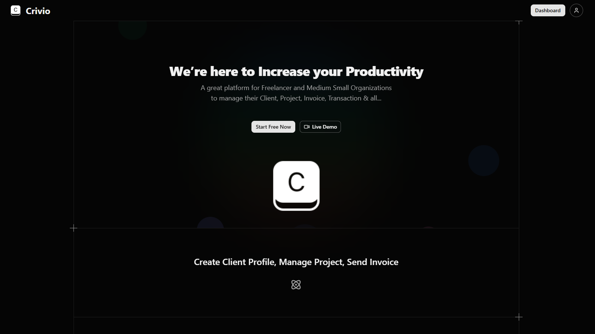

# Crivio – CRM & Invoice **Manager**
Crivio is a lightweight CRM + invoice manager built for freelancers and small teams who don’t want enterprise bloat.

 

### Features
- Client management
- Invoice creation & tracking
- Project / deal tracking
- Payment status (paid / pending / overdue)
- Simple dashboard
- Auth (GitHub / Email)
- Clean REST API

### Tech Stack
- Backend: Express Js
- Frontend: Next Js
- Database: MongoDB
- Auth: Firebase (Google, GitHub, Email)